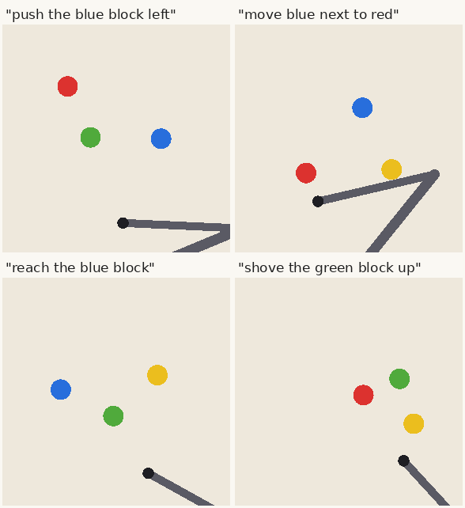

# picovla

A vision-language-action robot policy written from scratch in about 470 lines of PyTorch. It looks at a 64x64 picture, reads an English instruction and moves a two-link arm. It trains in 40 minutes on a CPU, and the same weights run in your browser in plain JavaScript.

**[Try it in the browser](https://tahakocp.github.io/picovla/)** (3.6 MB, no install, nothing leaves the page)



None of these scenes were in the training data, and "shove the green block up" is a phrasing it never saw. The bottom-right one fails, which is close to the real rate: the table below has the numbers.

```bash
git clone https://github.com/tahakocp/picovla && cd picovla
pip install -r requirements.txt --extra-index-url https://download.pytorch.org/whl/cpu   # CPU torch is enough
python -m picovla.evaluate --ablate      # score the shipped weights, ~30 s
```

## What it does, measured

200 fixed random scenes per task, none of them in the training data. Success means the task check in `sim.py` passed within 120 steps.

| task | example | trained phrasing | unseen phrasing | scripted expert |
|---|---|---|---|---|
| touch | "touch the red block" | 100% | 97.5% | 100% |
| push | "push the blue block left" | 78.0% | 79.0% | 100% |
| toward | "move green next to yellow" | 58.5% | 50.0% | 100% |
| all | | 78.8% | 75.5% | 100% |

Does it actually read the words? Same 200 scenes per task, but the instruction names a different block:

| task | still does the original task | does what the new words say |
|---|---|---|
| touch | 30.5% | 100% |
| push | 0.0% | 79.5% |
| toward | 4.0% | 61.0% |

So the instruction changes the behaviour, and the policy follows the new one about as well as the original. Touch counts as soon as the fingertip comes close, so brushing past the original block on the way to the new one also scores; that is where the 30.5% comes from.


Numbers come from `docs/eval.json`, produced by `python -m picovla.evaluate --ablate --expert --out docs/eval.json`. Every scene, task and phrase comes from a fixed seed, so you should get the same table.

| | |
|---|---|
| parameters | 902,210 |
| demonstrations | 3,000 episodes, 96,552 frames, collected in 27 s |
| training | 12,000 steps, batch 128, 2,388 s on an 8-vCPU Xeon cloud VM, no GPU |
| browser | 147 ms median per forward pass in headless Chrome on the same VM, one pass per 4 steps |
| Python core | 466 non-blank, non-comment lines in `picovla/` |
| JS forward pass | 124 lines in `web/model.js`, no ML library |

## How it works

Read the files in this order.

1. [`picovla/sim.py`](picovla/sim.py). A top-down table with three coloured discs and a two-link arm. Only the fingertip collides. The physics uses `+ - * /` and `sqrt` and nothing else, so `web/sim.js` reproduces it bit for bit.
2. [`picovla/expert.py`](picovla/expert.py). A scripted policy that solves every task: go behind the block, line up, push through. It only looks at the current state, so the cloned policy never sees two answers for one picture.
3. [`picovla/lang.py`](picovla/lang.py). 11 phrasing templates for training, 6 held out for testing, a 23-word vocabulary. No pretrained text model. The word embeddings start random like everything else.
4. [`picovla/data.py`](picovla/data.py). Runs the expert and records (image, words, fingertip, next 8 actions). Half the episodes add noise to the executed action but keep the clean label (DART). Without this the policy never learns to recover from its own small mistakes.
5. [`picovla/model.py`](picovla/model.py). Three strided convolutions turn the image into 64 patch tokens. Add 10 word tokens, one fingertip token and 8 learned action queries, run a 4-layer transformer over all 83 tokens, read 8 (dx, dy) actions off the query tokens. The attention is written out by hand so the JS port can follow it line by line.
6. [`picovla/train.py`](picovla/train.py). L1 loss on the action chunk, as in ACT. AdamW, one-cycle schedule.
7. [`picovla/evaluate.py`](picovla/evaluate.py). Closed loop: predict 8 actions, execute 4, look again.
8. [`picovla/export.py`](picovla/export.py) and [`web/model.js`](web/model.js). Weights to one float32 file, then the same forward pass in JavaScript.

This is the shape of real VLAs (OpenVLA, pi0, SmolVLA) with every part made as small as it can be: a vision encoder, a language encoder, a state input, one transformer, an action-chunk head. Real ones start from pretrained vision and language models, train on hours of robot data and predict 7-DoF actions. The toy keeps the plumbing and drops the scale.

## Train your own

```bash
python -m picovla.data --episodes 3000        # 1.2 GB in data/demos.npz
python -m picovla.train --steps 12000         # checkpoints/picovla.pt, ~40 min on 8 CPU cores
python -m picovla.evaluate --ckpt checkpoints/picovla.pt --ablate
python -m picovla.export                      # writes web/model.bin + web/model.json
npm run serve                                 # http://127.0.0.1:8000
```

The trained checkpoint is also attached to the [v0.1.0 release](https://github.com/tahakocp/picovla/releases/tag/v0.1.0).

## Tests

```bash
python -m unittest discover -s tests -v     # 10 tests
N=24 npm run e2e                            # needs Chrome; drives the real page
```

- The scripted expert solves at least 99% of 500 random scenes (100% of the 600 evaluation scenes).
- `web/sim.js` matches `sim.py` exactly (block and tip positions compared with `==`) over 40 episodes of 60 steps, half random actions, half expert. The drawn elbow may differ by one pixel because `atan2` and `acos` can differ by one ulp between libm and V8; the test allows 4 pixels in 40 frames.
- `web/model.js` matches the PyTorch forward pass within 2e-4 on four scenes, including an instruction with an unknown word.
- The e2e test loads the page in headless Chrome and runs instructions through the UI. Last local run: 18/24 done.

## Limits

- It is a 2D toy. Discs, a fingertip, no grasping, no friction model, no camera noise. Nothing here was run on a real robot.
- "toward" (push one block next to another) works about half the time. The expert needs to go round the block and the cloned policy often stops short or drifts past. More data did not fix it: a second run on 6,000 episodes for 20,000 steps scored 39% overall, so I kept the first one.
- Language understanding is word-level. It knows 21 words. Unknown words become `<unk>` and are ignored, which is why "shove" and "poke" still work: the colour and direction carry the meaning.
- Only one seed was trained for the shipped weights.

## Ideas for contributions

- A diffusion or flow-matching action head next to the L1 head, same data, same table.
- A wrist-camera view or a second camera.
- Swap the word embeddings for a small frozen text encoder and test phrasing it has never seen.
- A 3D version on MuJoCo with the same file layout.

See [CONTRIBUTING.md](CONTRIBUTING.md). If you add a feature, add its row to the results table.

## Credits

The policy follows ACT ([tonyzhaozh/act](https://github.com/tonyzhaozh/act)): action chunks, L1 loss, sim / scripted expert / record / train / evaluate split. DART noise injection is from Laskey et al., 2017. The flat, readable layout is inspired by [karpathy/nanoGPT](https://github.com/karpathy/nanoGPT). [keivalya/mini-vla](https://github.com/keivalya/mini-vla) is another small VLA worth reading, with a diffusion head on a MuJoCo task.

Every number above was measured on the machine described in the table.

MIT license.
